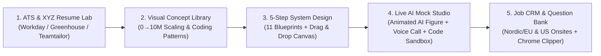

# InterviewOS — Unified Career, ATS, System Design & AI Mock Interview Platform

**InterviewOS** is a full-stack technical career and interview preparation platform built with **Next.js 15, React 19, TypeScript, Tailwind CSS, and SQLite 3 (`node:sqlite`)**. It unifies the core workflows of leading career platforms—**Hello Interview**, **Aced.io (Exponent / Pramp)**, **ByteByteGo**, **Jobscan**, **Teamtailor / Jobylon Nordic ATS**, and **Simplify / Huntr**—into a single progressive-disclosure workspace covering both **US Big Tech / AI Labs** and **European & Nordic Tech Leaders**.

---

## ⚡ One-Command Quick Start (`./start.sh`)

Everything needed to verify runtimes, install dependencies, initialize the **SQLite 3 (`data/interview_os.sqlite`)** database, type-check the codebase, and launch the server is contained in a single bash script: **[`start.sh`](./start.sh)**.

```bash
chmod +x start.sh
./start.sh
```

### Additional `start.sh` Options
```bash
# Wipe and re-seed the SQLite database with the latest blueprints, questions & job cards:
./start.sh --reset-db

# Build and start in production mode:
./start.sh --prod

# Run on a custom port (default is 3000):
PORT=3001 ./start.sh
```

Open **[http://localhost:3000](http://localhost:3000)** in your browser.

---

## ✨ Why InterviewOS?

Today's software engineers often juggle 4–5 disconnected subscriptions across different stages of their job search. **InterviewOS** connects context across the entire loop:



---

## 🌍 Global + Nordic & European Tech Localization

In addition to US Silicon Valley leaders (**OpenAI**, **Anthropic**, **Stripe**, **Uber**, **Meta**, **Google**, **Amazon**, **Databricks**, **Netflix**, **Airbnb**, **Apple**), InterviewOS features deep localization for **Europe's & the Nordics' top engineering employers**:

| Company / Group | Hubs | Signature Architecture & Interview Loop in InterviewOS |
| :--- | :--- | :--- |
| **Revolut** *(Europe's #1 Private Tech Co — \$45B–\$115B)* | London, Stockholm, Vilnius, Remote EU/Nordics | **Live TDD Coding** (*Thread-Safe Load Balancer Registry* — write unit tests first, zero Spring Boot magic!) + **Multi-Currency FX 30s Quote Lock & Double-Entry Atomic Ledger** (Java 21, Kotlin, jOOQ, PostgreSQL). |
| **FINN.no / Vend Marketplaces** *(FINN.no, Blocket.se, Qasa, Tori.fi, Oikotie, DBA.dk, Bilbasen)* | Oslo, Stockholm, Helsinki, Copenhagen | **Vespa / OpenSearch** sub-50ms geo-faceted search, ***"Fiks Ferdig"*** recommerce transactional escrow (Vipps/Klarna), and **Federated Kafka Data Mesh** with Avro/Protobuf Data Contracts. |
| **Schibsted Media** *(VG.no, Aftonbladet, Aftenposten, SvD, Omni)* | Oslo, Stockholm | **Varnish Cache Edge Shield** (originally born at VG.no!) using `stale-while-revalidate` (`beresp.grace`) + single-flight request coalescing to absorb **50x (300k QPS) breaking-news spikes**, plus **Schibsted Account (SPiD)** SSO. |
| **Spotify** | Stockholm HQ | **Spotify Connect** multi-device playback state sync (`<100ms` handoff via WebSockets/Dealer), CDN byte-range audio caching, **Production Incident Case Study**, and **Band Manifesto** Squad autonomy round. |
| **Klarna & Vipps MobilePay** | Stockholm, Oslo | **Sub-80ms BNPL Checkout Risk Engine** (BankID / Tink PSD2 signals) + **EU GDPR Article 17 Crypto-Shredding** (`per-user KMS DEK deletion`) on immutable Kafka audit logs. |
| **Wolt** | Helsinki HQ, Stockholm | **Production Take-Home API Defense & Live Refactoring** + **H3 Hexagonal 3-Sided Courier Batch Dispatch** under Nordic winter weather surges. |
| **Sana Labs, Cognite & Oura** | Stockholm, Oslo, Helsinki / Oulu | **Enterprise Multi-Tenant RAG with EU GDPR Residency** (Sana), **2M msg/sec Offshore Industrial IoT Ingestion** (Cognite), and **Biometric Ring HRV Time-Series Window Merging** (Oura). |

---

## 🚀 Key Features & Modules

### 1. ATS Scanner, File Parser & Google XYZ Bullet Optimizer (`src/components/AtsResumeLab.tsx`)
* **Multi-Format Resume Upload (`/api/parse-resume`):** Upload `.pdf`, `.docx`, `.txt`, or `.md` resumes with automatic multi-column/table layout warning detection.
* **5 Corporate & Nordic ATS Vendor Profiles (`Workday`, `Greenhouse`, `Lever`, `iCIMS / Taleo`, and `Teamtailor & Jobylon Nordic ATS`):** Simulate how specific ATS parsers weight and penalize your resume layout, acronyms, and keyword density.
* **1-Click Google XYZ Bullet Rewriter:** Audits every experience bullet and offers high-impact rewrites following Google's XYZ formula (*Accomplished [X] as measured by [Y], by doing [Z]*) that live-patch your resume and recalculate your ATS score immediately.
* **1-Click ATS-Clean PDF Export & SQLite Scan Logging:** Exports your optimized resume into a clean single-column PDF layout and logs historical scan snapshots to SQLite.

### 2. 5-Step Guided System Design + Drag-and-Drop Whiteboard (`src/components/SystemDesignPractice.tsx`)
* **11 Full Production Blueprints:**
  1. *Ticketmaster / Stripe High-Concurrency Seat Reservation*
  2. *Uber / Wolt Real-Time Geo-Spatial Dispatch (H3)*
  3. *WhatsApp Global Chat Fanout & Presence*
  4. *OpenAI / Anthropic LLM Inference & Disaggregated Prefill/Decode KV-Cache*
  5. *Multi-Tenant Enterprise RAG & Real-Time Zanzibar ACL Sync*
  6. *Dropbox / Google Drive Block-Level Delta Sync*
  7. *LeetCode Sandboxed Online Judge & Live Leaderboard*
  8. *Spotify Connect Multi-Device Playback Sync & Royalty Ledger (Stockholm)*
  9. *Klarna / Vipps Real-Time BNPL Risk Engine & GDPR Crypto-Shredding Ledger*
  10. *FINN.no / Vend Marketplaces (Vespa Search & Fiks Ferdig Escrow) & VG.no Varnish Edge (Schibsted)*
  11. *Revolut Multi-Currency FX Exchange (30s Quote Lock) & Double-Entry Atomic Ledger*
* **Interactive Whiteboard Canvas & Live Traffic / Chaos Monkey Simulator:** Drag nodes smoothly across the canvas, wire components with animated Cubic Bezier data-flow curves, simulate **1x → 10x → 50x (300k QPS) Traffic Spikes**, or click **Chaos Kill** on any node to watch real-time CPU saturation, P99 latency spikes, and packet drop rates across your topology.

### 3. Live AI Mock Interview Studio: Animated AI Figure, PR Bug-Squash Arena & 5-Language Code Sandbox (`src/components/MockInterviewStudio.tsx`, `src/components/AiInterviewerStage.tsx`, `src/components/PrBugSquashArena.tsx`)
* **Animated AI Interviewer Figure & Voice Delivery Telemetry (`AiInterviewerStage.tsx`):**
  * Talk face-to-face with company-specific AI Interviewer personas (*Lukas Kazlauskas* at **Revolut**, *Henrik Solberg* at **FINN.no / Vend & VG**, *Astrid Lindholm* at **Spotify**, *Maja Virtanen* at **Klarna / Wolt**, *Marcus Vance* at **Stripe**, *Dr. Elena Rostova* at **OpenAI / Anthropic**, etc.).
  * Features **real-time lip-sync (4 mouth viseme states)**, natural eye blinking, **Hands-Free Continuous Voice Call Mode**, **Candidate Self-View Webcam Picture-in-Picture (PiP)**, and a live **Voice & Delivery Coach HUD** tracking your **Speaking Pace (WPM)**, **Filler-Word Count (`"um/like"`)**, and **Quantitative Metric Density**.
* **PR Bug-Squash & Live Take-Home Mutation Simulator (`PrBugSquashArena.tsx`):**
  * Click directly on lines of realistic Kotlin/Java/TypeScript Pull Requests from **FINN.no / Vend (*Fiks Ferdig* Escrow)**, **Revolut / Klarna (Multi-Currency FX Ledger)**, and **VG.no / Wolt (Breaking-News Edge & Surge Handler)** to flag subtle production bugs (race conditions, IEEE-754 float money math, AB-BA deadlocks, N+1 queries, synchronous dual-writes) and defend live requirement mutations.
* **5-Language Code Sandbox (`/api/execute`):** Execute and verify **JavaScript / TypeScript**, **Python 3**, **Java 21**, **Kotlin**, and **Go** against 6 real test harnesses including **Revolut's Live TDD Thread-Safe Load Balancer Registry**, `LRU Cache`, `Sliding Window Rate Limiter`, `Topological Sort`, `Merge Overlapping Intervals`, and `Top-K Frequent Elements`.

### 4. Visual Architecture & Coding Patterns Library (`src/components/VisualLibrary.tsx`)
* **Interactive 0 → 10M+ Users Architecture Slider:** Step through 5 progressive scaling stages with live P95 latency, availability SLA, and max QPS metrics.
* **Algorithmic Pointer & Stack Visualizer:** Step forward and backward through *Dynamic Sliding Window*, *Monotonic Decreasing Stack*, and *Converging Two Pointers* array state transitions.

### 5. Crowdsourced Company Question Bank, Annotated Walkthroughs & Live Scraper (`src/components/QuestionBank.tsx`)
* **Verified Company Questions & Nordic Hub Filter:** Filter 25+ verified onsite questions across **Revolut**, **FINN.no / Vend**, **Blocket / Tori**, **VG / Schibsted**, **Spotify**, **Klarna**, **Wolt**, **Sana Labs**, **Cognite**, **Oura**, **OpenAI**, **Anthropic**, **Stripe**, **Uber**, **Meta**, and **Google**.
* **Annotated Onsite Walkthroughs & Applicant Post-Mortems:** Read timestamped Hiring Committee transcripts for **Revolut (Live TDD + FX Ledger)**, **FINN.no / Vend & VG.no (Fiks Ferdig Escrow + Varnish 300k QPS Spike)**, **Spotify (Production Case Study + Band Manifesto)**, **Wolt (Take-Home Live Defense)**, and **Stripe (L6 Ledger Idempotency)**.
* **Automated Live Community Feed Scraper & Post Extractor (`/api/ingest-questions`):** Syncs public interview experiences from **Hacker News Algolia API** and verified onsite feeds, or extracts structured questions from raw Reddit/Blind/LeetCode Discuss posts into SQLite.

### 6. Job Application Kanban CRM, Nordic Offer Comparator & Chrome Extension (`src/components/JobTrackerCrm.tsx` & `src/components/NordicOfferComparator.tsx`)
* **Kanban Pipeline + 1-Click JD Clipper:** Track applications across US and Nordic/European roles (`SEK`, `NOK`, `EUR`, `USD`) with automatic ATS match scoring.
* **Nordic & European Offer, Pension (`OTP` / `ITP1`) & Expat Tax Comparator (`NordicOfferComparator.tsx`):** Compare offers across **Oslo (`NOK`)**, **Stockholm (`SEK`)**, **Helsinki (`EUR`)**, and **London / Revolut (`EUR/GBP`)**, factoring in Norway's `7% OTP + 12% Feriepenger` & `25% Kildeskatt`, Sweden's `30% ITP1 Tjänstepension` & `Expertskatt`, Finland's `32% Key Employee Tax`, and a 1-click **Polite Counter-Offer Email Generator**.
* **1-Click Chrome Extension Clipper (`chrome-extension/` + `/api/extension/clip`):** Loadable Manifest V3 Chrome extension that clips Job Descriptions or Onsite Interview Questions from LinkedIn, Greenhouse, Workday, Jobylon, or Teamtailor directly into your local SQLite database.

---

## 🛠️ Project Structure

```text
├── start.sh                          # All-in-one Bash bootstrap & launch script
├── chrome-extension/                 # Loadable Manifest V3 Chrome Extension Clipper
│   ├── manifest.json
│   ├── popup.html
│   └── popup.js
└── src/
    ├── app/
    │   ├── api/
    │   │   ├── ai/route.ts               # Live LLM proxy (Gemini / OpenAI / Anthropic)
    │   │   ├── db/route.ts               # SQLite 3 relational CRUD & telemetry API
    │   │   ├── questions/route.ts        # SQLite question bank filter, upvote & submission API
    │   │   ├── ingest-questions/route.ts # Live HN/Reddit/LeetCode scraper & post extractor
    │   │   ├── extension/clip/route.ts   # CORS-enabled Chrome Extension JD & Question clipper
    │   │   ├── execute/route.ts          # Sandboxed JS/TS (Node VM) & Python 3 code runner
    │   │   └── parse-resume/route.ts     # PDF / DOCX / TXT resume text & layout parser
    │   ├── globals.css
    │   ├── layout.tsx
    │   └── page.tsx                      # Main workspace shell & Command Center
    ├── components/
    │   ├── Navbar.tsx                    # Left sidebar, L4-L6 bar, SQLite DB Inspector & AI modal
    │   ├── AtsResumeLab.tsx              # 3-step ATS scanner, vendor calibration & XYZ rewriter
    │   ├── SystemDesignPractice.tsx      # 5-step guided practice & drag-and-drop canvas
    │   ├── MockInterviewStudio.tsx       # AI mock studio, company rubrics & live code runner
    │   ├── AiInterviewerStage.tsx        # Animated AI Interviewer Figure, lip-sync & webcam PiP
    │   ├── VisualLibrary.tsx             # Interactive 0->10M scaling & coding pattern stepper
    │   ├── QuestionBank.tsx              # Question bank, Nordic walkthroughs & live scraper
    │   └── JobTrackerCrm.tsx             # Kanban CRM, 1-click JD clipper & STAR story bank
    └── lib/
        ├── types.ts
        ├── server/
        │   └── sqliteDb.ts               # SQLite 3 WAL engine, 8-table schema & auto-seeding
        ├── data/
        │   ├── companyRubrics.ts         # Insider company rubrics & corporate/Nordic ATS profiles
        │   ├── systemDesignProblems.ts   # 11 full 5-step System Design blueprints
        │   ├── visualLibraryData.ts
        │   └── mockInterviewData.ts      # Coding sandbox problems, verified questions & CRM cards
        └── engines/
            ├── atsEngine.ts
            └── aiEvaluationEngine.ts
```
