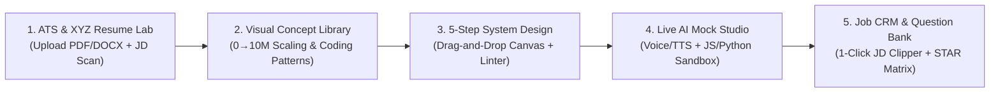

# InterviewOS — Unified Career, ATS, System Design & AI Mock Interview Platform

**InterviewOS** is an all-in-one technical career and interview preparation platform built with **Next.js 15, React 19, TypeScript, and Tailwind CSS**. It unifies the core workflows of leading career platforms—**Hello Interview**, **Aced.io (Exponent / Pramp)**, **ByteByteGo**, **Jobscan**, **Resume Worded**, and **Simplify / Huntr**—into a single, progressive-disclosure workspace.

---

## ✨ Why InterviewOS?

Today's job applicants often juggle 4–5 disconnected subscriptions across different stages of their job search. **InterviewOS** connects context across the entire loop:



---

## 🚀 Key Features & Modules

### 1. ATS Scanner, File Parser & Google XYZ Bullet Optimizer (`src/components/AtsResumeLab.tsx`)
* **Multi-Format Resume Upload (`/api/parse-resume`):** Upload `.pdf`, `.docx`, `.txt`, or `.md` resumes with automatic multi-column/table layout warning detection.
* **Keyword & Architecture Gap Engine:** Compares your resume against any target Job Description across *Hard Skills*, *Distributed Systems Architecture*, *Quantified Impact Density*, and *ATS Parsability*.
* **1-Click Google XYZ Bullet Rewriter:** Audits every experience bullet and offers high-impact rewrites following Google's XYZ formula (*Accomplished [X] as measured by [Y], by doing [Z]*) that live-patch your resume and recalculate your ATS score immediately.
* **1-Click ATS-Clean PDF Export:** Exports your optimized resume into a clean, single-column printable/saveable PDF layout.

### 2. 5-Step Guided System Design + Drag-and-Drop Whiteboard (`src/components/SystemDesignPractice.tsx`)
* **Chronological Delivery Framework:** Guides candidates through a time-boxed 45-minute roadmap:
  1. *Requirements & CAP Stance (5m)*
  2. *Back-of-the-Envelope Estimations (5m)*
  3. *API Endpoints & Storage Schema (7m)*
  4. *Interactive Drag-and-Drop Architecture Canvas (13m)*
  5. *Calibrated L4 / L5 / L6 Deep Dives (15m)*
* **Interactive Whiteboard Canvas:** Drag nodes smoothly across the canvas, wire components with animated Cubic Bezier data-flow curves, or load the **FAANG Reference Topology** in one click.
* **Automated Topology Linter (SPOF Detector):** Inspects your live graph for Single Points of Failure (e.g., missing Edge Gateway, missing Redis cache layer, or a Client connecting directly to a Database).

### 3. Live AI Mock Interview Studio + Real Code Sandbox (`src/components/MockInterviewStudio.tsx`)
* **4 Interview Tracks:** *System Design*, *Coding (Live Sandbox)*, *Behavioral STAR*, and *Resume + JD Deep Dive*.
* **Real Sandboxed Code Runner (`/api/execute`):** Execute **JavaScript / TypeScript** (isolated Node `vm`) and **Python 3** against real test harnesses (`LRU Cache`, `Sliding Window Rate Limiter`, `Topological Sort`), reporting real execution latency (`ms`) and return values.
* **Voice Input & Interviewer TTS:** Speak answers out loud via Web Speech API and toggle voice synthesis for the AI interviewer.
* **Level-Calibrated Rubric Scorecards (`L4` / `L5` / `L6`):** Generates 4-dimension committee evaluations (*Strong Hire*, *Hire*, *Lean Hire*, *Lean No-Hire*) with sample stronger answers.

### 4. Visual Architecture & Coding Patterns Library (`src/components/VisualLibrary.tsx`)
* **Interactive 0 → 10M+ Users Architecture Slider:** Step through 5 progressive scaling stages with live P95 latency, availability SLA, and max QPS metrics.
* **Algorithmic Pointer & Stack Visualizer:** Step forward and backward through *Dynamic Sliding Window*, *Monotonic Decreasing Stack*, and *Converging Two Pointers* array state transitions.
* **Distributed Caching Trade-off Matrix & Latency Numbers Reference.**

### 5. Crowdsourced Company Question Bank & Peer Mode (`src/components/QuestionBank.tsx`)
* **Verified Company Questions:** Browse and filter recently asked onsite questions from **OpenAI**, **Stripe**, **Uber**, **Anthropic**, **Meta**, and **Google**, reveal hidden Hiring Committee signals, upvote reports, or submit new questions.
* **Annotated L6 Walkthrough & Peer Rubric:** Inspect timestamped Hiring Committee commentary or use the reciprocal **Peer Interviewer Grading Checklist** (Pramp / Aced Practice style).

### 6. Job Application Kanban CRM & STAR Story Matrix (`src/components/JobTrackerCrm.tsx`)
* **Kanban Pipeline + 1-Click JD Clipper:** Paste any raw Job Description to automatically extract the company, role, level (`L4`–`L6`), live ATS match %, and linked System Design prep card onto your board.
* **Behavioral STAR Story Bank:** Maintain leadership stories mapped to *Conflict Resolution*, *Ambiguity*, *Technical Complexity*, and *Speed vs. Quality*.

---

## 🛠️ Tech Stack & Architecture

* **Framework:** Next.js 15 (App Router) + React 19 + TypeScript
* **Styling:** Tailwind CSS v4 + Lucide Icons (Progressive Disclosure dark UI)
* **AI & Evaluation Engine:** Hybrid architecture—works **100% out-of-the-box** using the deterministic FAANG Rubric & ATS Engine (`src/lib/engines/`), with optional live API key integration for **Google Gemini**, **OpenAI GPT-4o**, or **Anthropic Claude** (`/api/ai`).
* **Persistence:** Dual `localStorage` + server-side JSON database (`/api/db`).

```text
src/
├── app/
│   ├── api/
│   │   ├── ai/route.ts            # Live LLM proxy (Gemini / OpenAI / Anthropic)
│   │   ├── db/route.ts            # Local JSON database persistence
│   │   ├── execute/route.ts       # Sandboxed JS/TS (Node VM) & Python 3 code runner
│   │   └── parse-resume/route.ts  # PDF / DOCX / TXT resume text & layout parser
│   ├── globals.css
│   ├── layout.tsx
│   └── page.tsx                   # Main workspace shell & Command Center
├── components/
│   ├── Navbar.tsx                 # Left sidebar navigation, L4-L6 bar & AI modal
│   ├── AtsResumeLab.tsx           # 3-step ATS scanner, PDF upload/export & XYZ rewriter
│   ├── SystemDesignPractice.tsx   # 5-step guided practice & drag-and-drop canvas
│   ├── MockInterviewStudio.tsx    # Voice/text AI mock studio & multi-language code runner
│   ├── VisualLibrary.tsx          # Interactive 0->10M scaling & coding pattern stepper
│   ├── QuestionBank.tsx           # Company question bank, annotated walkthrough & peer mode
│   └── JobTrackerCrm.tsx          # Kanban CRM, 1-click JD clipper & STAR story bank
└── lib/
    ├── types.ts
    ├── data/
    │   ├── systemDesignProblems.ts
    │   ├── visualLibraryData.ts
    │   └── mockInterviewData.ts
    └── engines/
        ├── atsEngine.ts
        └── aiEvaluationEngine.ts
```

---

## ⚡ Getting Started

### 1. Install dependencies
```bash
npm install
```

### 2. Start the development server
```bash
npm run dev
```

Open [http://localhost:3000](http://localhost:3000) in your browser.

### 3. Production build
```bash
npm run build
npm start
```
