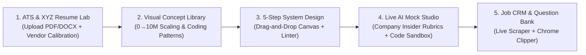

# InterviewOS — Unified Career, ATS, System Design & AI Mock Interview Platform

**InterviewOS** is an all-in-one technical career and interview preparation platform built with **Next.js 15, React 19, TypeScript, Tailwind CSS, and SQLite 3 (`node:sqlite`)**. It unifies the core workflows of leading career platforms—**Hello Interview**, **Aced.io (Exponent / Pramp)**, **ByteByteGo**, **Jobscan**, **Resume Worded**, and **Simplify / Huntr**—into a single, progressive-disclosure workspace.

---

## ✨ Why InterviewOS?

Today's job applicants often juggle 4–5 disconnected subscriptions across different stages of their job search. **InterviewOS** connects context across the entire loop:



---

## 🚀 Key Features & Modules

### 1. ATS Scanner, File Parser & Google XYZ Bullet Optimizer (`src/components/AtsResumeLab.tsx`)
* **Multi-Format Resume Upload (`/api/parse-resume`):** Upload `.pdf`, `.docx`, `.txt`, or `.md` resumes with automatic multi-column/table layout warning detection.
* **Corporate ATS Vendor Parser Calibration (`Workday`, `Greenhouse`, `Lever`, `iCIMS / Taleo`):** Simulate how specific corporate ATS parsers weight and penalize your resume layout, acronyms, and keyword density.
* **1-Click Google XYZ Bullet Rewriter:** Audits every experience bullet and offers high-impact rewrites following Google's XYZ formula (*Accomplished [X] as measured by [Y], by doing [Z]*) that live-patch your resume and recalculate your ATS score immediately.
* **1-Click ATS-Clean PDF Export & SQLite Scan Logging:** Exports your optimized resume into a clean single-column PDF layout and logs historical scan snapshots to SQLite.

### 2. 5-Step Guided System Design + Drag-and-Drop Whiteboard (`src/components/SystemDesignPractice.tsx`)
* **Chronological Delivery Framework:** Guides candidates through a time-boxed 45-minute roadmap:
  1. *Requirements & CAP Stance (5m)*
  2. *Back-of-the-Envelope Estimations (5m)*
  3. *API Endpoints & Storage Schema (7m)*
  4. *Interactive Drag-and-Drop Architecture Canvas (13m)*
  5. *Calibrated L4 / L5 / L6 Deep Dives (15m)*
* **Interactive Whiteboard Canvas:** Drag nodes smoothly across the canvas, wire components with animated Cubic Bezier data-flow curves, or load the **FAANG Reference Topology** in one click.
* **Automated Topology Linter (SPOF Detector):** Inspects your live graph for Single Points of Failure (e.g., missing Edge Gateway, missing Redis cache layer, or a Client connecting directly to a Database).

### 3. Live AI Mock Interview Studio + Real Code Sandbox (`src/components/MockInterviewStudio.tsx`)
* **Company-Specific Insider Grading Rubrics (`src/lib/data/companyRubrics.ts`):** Switch your AI Mock Interviewer between **Stripe** (*Production Pragmatism & Idempotency*), **OpenAI / Anthropic** (*GPU Roofline & Agentic Sandboxing*), **Amazon** (*Bar Raiser & 16 Leadership Principles*), **Meta** (*35-min 2-Problem Speed Coding & Planet-Scale Fanout*), and **Google** (*GCA & Progressive Constraint Mutation*), complete with Must-Hit Signals and Auto-Downgrade Red Flags.
* **Real Sandboxed Code Runner (`/api/execute`):** Execute **JavaScript / TypeScript** (isolated Node `vm`) and **Python 3** against real test harnesses (`LRU Cache`, `Sliding Window Rate Limiter`, `Topological Sort`, `Merge Overlapping Intervals`, `Top-K Frequent Elements`), reporting real execution latency (`ms`) and return values.
* **Voice Input & Interviewer TTS:** Speak answers out loud via Web Speech API and toggle voice synthesis for the AI interviewer.

### 4. Visual Architecture & Coding Patterns Library (`src/components/VisualLibrary.tsx`)
* **Interactive 0 → 10M+ Users Architecture Slider:** Step through 5 progressive scaling stages with live P95 latency, availability SLA, and max QPS metrics.
* **Algorithmic Pointer & Stack Visualizer:** Step forward and backward through *Dynamic Sliding Window*, *Monotonic Decreasing Stack*, and *Converging Two Pointers* array state transitions.

### 5. Crowdsourced Company Question Bank & Automated Live Scraper (`src/components/QuestionBank.tsx`)
* **Verified Company Questions:** Browse and filter recently asked onsite questions from **OpenAI**, **Stripe**, **Uber**, **Anthropic**, **Meta**, **Google**, **Databricks**, **Netflix**, **Airbnb**, and **Apple**.
* **Automated Live Community Feed Scraper & Post Extractor (`/api/ingest-questions`):** Syncs public interview experiences from **Hacker News Algolia API**, **r/ExperiencedDevs**, **r/leetcode**, and verified onsite feeds, or extracts structured `{ company, level, roundType, rubricSignal }` rows from any raw unstructured Reddit/Blind/LeetCode Discuss post directly into SQLite.
* **Annotated L6 Walkthrough & Peer Rubric:** Inspect timestamped Hiring Committee commentary or use the reciprocal **Peer Interviewer Grading Checklist** (Pramp / Aced Practice style).

### 6. Job Application Kanban CRM, STAR Matrix & Chrome Extension (`src/components/JobTrackerCrm.tsx`)
* **Kanban Pipeline + 1-Click JD Clipper:** Paste any raw Job Description to automatically extract the company, role, level (`L4`–`L6`), live ATS match %, and linked System Design prep card onto your board.
* **1-Click Chrome Extension Clipper (`chrome-extension/` + `/api/extension/clip`):** Loadable Manifest V3 Chrome extension that clips Job Descriptions or Onsite Interview Questions from LinkedIn, Greenhouse, Workday, or Lever directly into your local SQLite database and returns an instant ATS Match Score.
* **Behavioral STAR Story Bank:** Maintain leadership stories mapped to *Conflict Resolution*, *Ambiguity*, *Technical Complexity*, and *Speed vs. Quality*.

---

## 🛠️ Tech Stack & Architecture

* **Framework:** Next.js 15 (App Router) + React 19 + TypeScript
* **Styling:** Tailwind CSS v4 + Lucide Icons (Progressive Disclosure dark UI)
* **AI & Evaluation Engine:** Hybrid architecture—works **100% out-of-the-box** using the deterministic FAANG Rubric & ATS Engine (`src/lib/engines/`), with optional live API key integration for **Google Gemini**, **OpenAI GPT-4o**, or **Anthropic Claude** (`/api/ai`).
* **Persistence & Relational Database:** Powered by **SQLite 3 (`node:sqlite` in WAL mode)** at `data/interview_os.sqlite` with 8 normalized tables (`users`, `system_design_problems`, `coding_problems`, `question_bank`, `job_applications`, `star_stories`, `practice_sessions`, `resume_scans`), automatic schema migration/seeding, and an interactive **SQLite Relational DB Inspector** in the sidebar.

```text
├── chrome-extension/              # Loadable Manifest V3 Chrome Extension Clipper
│   ├── manifest.json
│   ├── popup.html
│   └── popup.js
└── src/
    ├── app/
    │   ├── api/
    │   │   ├── ai/route.ts               # Live LLM proxy (Gemini / OpenAI / Anthropic)
    │   │   ├── db/route.ts               # SQLite 3 relational CRUD & telemetry API
    │   │   ├── questions/route.ts        # SQLite question bank filter, upvote & submission API
    │   │   ├── ingest-questions/route.ts # Live HN/Reddit/LeetCode scraper & post extractor
    │   │   ├── extension/clip/route.ts   # CORS-enabled Chrome Extension JD & Question clipper
    │   │   ├── execute/route.ts          # Sandboxed JS/TS (Node VM) & Python 3 code runner
    │   │   └── parse-resume/route.ts     # PDF / DOCX / TXT resume text & layout parser
    │   ├── globals.css
    │   ├── layout.tsx
    │   └── page.tsx                      # Main workspace shell & Command Center
    ├── components/
    │   ├── Navbar.tsx                    # Left sidebar, L4-L6 bar, SQLite DB Inspector & AI modal
    │   ├── AtsResumeLab.tsx              # 3-step ATS scanner, vendor calibration & XYZ rewriter
    │   ├── SystemDesignPractice.tsx      # 5-step guided practice & drag-and-drop canvas
    │   ├── MockInterviewStudio.tsx       # Voice/text AI mock studio, company rubrics & code runner
    │   ├── VisualLibrary.tsx             # Interactive 0->10M scaling & coding pattern stepper
    │   ├── QuestionBank.tsx              # Question bank, live scraper & peer mode
    │   └── JobTrackerCrm.tsx             # Kanban CRM, 1-click JD clipper & STAR story bank
    └── lib/
        ├── types.ts
        ├── server/
        │   └── sqliteDb.ts               # SQLite 3 WAL engine, 8-table schema & auto-seeding
        ├── data/
        │   ├── companyRubrics.ts         # Insider company rubrics & corporate ATS vendor profiles
        │   ├── systemDesignProblems.ts
        │   ├── visualLibraryData.ts
        │   └── mockInterviewData.ts
        └── engines/
            ├── atsEngine.ts
            └── aiEvaluationEngine.ts
```

---

## ⚡ Getting Started

### 1. Install dependencies
```bash
npm install
```

### 2. Start the development server
```bash
npm run dev
```

Open [http://localhost:3000](http://localhost:3000) in your browser.
